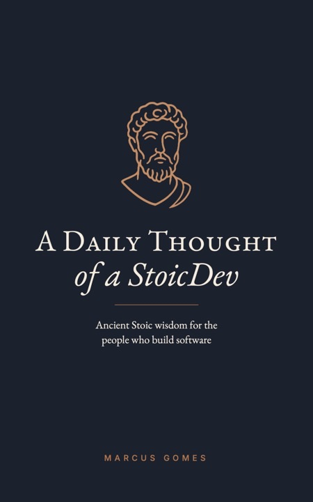

# A Daily Thought of a StoicDev

**One Stoic thought a day for people who build software.**

366 short reflections, one for every day of the year (February 29 included). Each page opens with a passage from Marcus Aurelius, Epictetus or Seneca, then a few paragraphs on what it means for a working developer: the legacy codebase nobody wants to touch, the deadline you didn't set, the review comment that stings.

The whole book is free to read here.

- **Today's thought:** [stoic-developer.com](https://www.stoic-developer.com)
- **The book on Amazon:** [Paperback](https://www.amazon.com/dp/B0HP8GRVM7) · [Kindle](https://www.amazon.com/s?k=A+Daily+Thought+of+a+StoicDev+Marcus+Gomes&i=digital-text)
- **Follow:** [YouTube](https://www.youtube.com/@stoic-developer) · [LinkedIn](https://www.linkedin.com/company/stoic-developer) · [X](https://x.com/StoicDevelop)

 

## What a page looks like

From [January 1](./book/01_January/01.md), *Control and Focus*:

> You inherit a codebase nobody wants to touch. No docs, no tests, a commit history full of messages like "fix" and "fix again." The first reaction is to get angry: at whoever wrote it, at the deadline, at the manager who promised it would take two days.
>
> None of that is yours to change. The code is already written. The deadline was set before you joined the call.
>
> What is yours is the next hour.

## Where to start

- Read [the introduction](./book/00_Prologue/Introduction.md): who wrote this and why.
- Open today's date in the index below, or on [the website](https://www.stoic-developer.com).
- Or start at [January 1](./book/01_January/01.md) and read one page a day.

## The year at a glance

Each month has one focus, so the year builds from what you control to how you spend your time.

| Month | Focus | |
|---|---|---|
| [I. January](./book/01_January/README.md) | Control | 31 days |
| [II. February](./book/02_February/README.md) | Calm | 29 days |
| [III. March](./book/03_March/README.md) | Self-Knowledge | 31 days |
| [IV. April](./book/04_April/README.md) | Judgment | 30 days |
| [V. May](./book/05_May/README.md) | Action | 31 days |
| [VI. June](./book/06_June/README.md) | Adaptability | 30 days |
| [VII. July](./book/07_July/README.md) | Integrity | 31 days |
| [VIII. August](./book/08_August/README.md) | Practice | 31 days |
| [IX. September](./book/09_September/README.md) | Resilience | 30 days |
| [X. October](./book/10_October/README.md) | Kindness | 31 days |
| [XI. November](./book/11_November/README.md) | Letting Go | 30 days |
| [XII. December](./book/12_December/README.md) | Time | 31 days |

## Every day

<b>January</b>: Control

1. [Control and Focus](./book/01_January/01.md)
2. [Overcome Impostor Syndrome](./book/01_January/02.md)
3. [The Art of Saying 'No'](./book/01_January/03.md)
4. [The Big Three](./book/01_January/04.md)
5. [Understand Your Goals](./book/01_January/05.md)
6. [Discovering Your True North in Tech](./book/01_January/06.md)
7. [Mastering the Mind: A Developer's Guide](./book/01_January/07.md)
8. [Breaking Free from Habitual Vices in Development](./book/01_January/08.md)
9. [Navigating Control in Professional Challenges](./book/01_January/09.md)
10. [If You Want to Be Steady](./book/01_January/10.md)
11. [If You Want to Be Unsteady](./book/01_January/11.md)
12. [The One Path to Serenity](./book/01_January/12.md)
13. [Circle of Control](./book/01_January/13.md)
14. [Mastering the Mind Amid Digital Tempests](./book/01_January/14.md)
15. [The Developer's Path to Clarity and Conviction](./book/01_January/15.md)
16. [Rethinking Routine: The Developer's Guide to Intentional Action](./book/01_January/16.md)
17. [Initiating Action: Beyond Fear of Failure](./book/01_January/17.md)
18. [Perceiving Grace in the Mundane](./book/01_January/18.md)
19. [Choice: Your Constant Companion](./book/01_January/19.md)
20. [Renewing Your Perspective](./book/01_January/20.md)
21. [Crafting Your Dawn Reflections](./book/01_January/21.md)
22. [Reflecting to Forge Ahead](./book/01_January/22.md)
23. [Unveiling the Illusion of Wealth](./book/01_January/23.md)
24. [Cultivating Depth in Understanding](./book/01_January/24.md)
25. [Valuing the Essential](./book/01_January/25.md)
26. [Harnessing Your Inner Guide](./book/01_January/26.md)
27. [Essential Training for the Stoic Developer](./book/01_January/27.md)
28. [Emulating the Virtuous](./book/01_January/28.md)
29. [The Art of Focused Simplicity](./book/01_January/29.md)
30. [Embracing Selective Ignorance](./book/01_January/30.md)
31. [Nurturing the Mind: Stoicism as Therapy](./book/01_January/31.md)

<b>February</b>: Calm

1. [Cultivating Calm in the Code](./book/02_February/01.md)
2. [Mastering Emotional Independence](./book/02_February/02.md)
3. [Unraveling the Roots of Anxiety](./book/02_February/03.md)
4. [Cultivating Emotional Resilience](./book/02_February/04.md)
5. [Balancing Impulses with Wisdom](./book/02_February/05.md)
6. [Choosing Peace Over Conflict](./book/02_February/06.md)
7. [Breaking the Cycle of Fear](./book/02_February/07.md)
8. [Questioning Emotional Relief](./book/02_February/08.md)
9. [The Freedom of Neutrality](./book/02_February/09.md)
10. [The Toxicity of Anger](./book/02_February/10.md)
11. [Sovereign of Self: Hero or Nero?](./book/02_February/11.md)
12. [Safeguarding Your Inner Sanctuary](./book/02_February/12.md)
13. [The Illusion of Indulgence](./book/02_February/13.md)
14. [Harnessing Rational Thought](./book/02_February/14.md)
15. [Dissolving Nightmares of the Mind](./book/02_February/15.md)
16. [Simplifying the Path to Virtue](./book/02_February/16.md)
17. [Contentment in the Present](./book/02_February/17.md)
18. [Mastery Over Impressions: Weathering Life's Storms](./book/02_February/18.md)
19. [Savoring Life's Offerings with Stoic Grace](./book/02_February/19.md)
20. [Reflecting on the Allure of Excess](./book/02_February/20.md)
21. [The Freedom in Wanting Less](./book/02_February/21.md)
22. [The Power of Thoughtful Silence](./book/02_February/22.md)
23. [Rising Above Reactive Emotions](./book/02_February/23.md)
24. [Mastering Your Response](./book/02_February/24.md)
25. [The Futility of Anger and Ambition](./book/02_February/25.md)
26. [Focus on What Matters](./book/02_February/26.md)
27. [Balancing Passion and Indifference in the Tech World](./book/02_February/27.md)
28. [Regaining Equilibrium Amidst Turmoil](./book/02_February/28.md)
29. [The Art of Focused Mastery](./book/02_February/29.md)

<b>March</b>: Self-Knowledge

1. [Igniting the Flame of Self-Awareness](./book/03_March/01.md)
2. [The Balance of Self-Perception](./book/03_March/02.md)
3. [Choosing Unity Over Fragmentation](./book/03_March/03.md)
4. [Cultivating Authentic Freedom](./book/03_March/04.md)
5. [The Hidden Price of Excess](./book/03_March/05.md)
6. [Resisting the Lure of Personal Narratives](./book/03_March/06.md)
7. [Beyond Sensory Illusions](./book/03_March/07.md)
8. [Guarding the Fortress of Your Mind](./book/03_March/08.md)
9. [Curating Your Circle for Growth](./book/03_March/09.md)
10. [The Guiding Light of Exemplary Figures](./book/03_March/10.md)
11. [The True Currency of Freedom](./book/03_March/11.md)
12. [Empathy in Understanding](./book/03_March/12.md)
13. [Trusting the Larger Design](./book/03_March/13.md)
14. [The Barrier of Ego](./book/03_March/14.md)
15. [Embracing the Gift of Now](./book/03_March/15.md)
16. [Cherishing Your Inner Compass](./book/03_March/16.md)
17. [Essence of True Beauty](./book/03_March/17.md)
18. [Mastering Internal Triggers](./book/03_March/18.md)
19. [The Power of Perspective](./book/03_March/19.md)
20. [Poised for the Unpredictable](./book/03_March/20.md)
21. [Inner Haven: Your Personal Retreat](./book/03_March/21.md)
22. [The Essence of True Education](./book/03_March/22.md)
23. [The Straitjacketed Soul](./book/03_March/23.md)
24. [Living Philosophy Daily](./book/03_March/24.md)
25. [The Simplicity of Wealth and Freedom](./book/03_March/25.md)
26. [Mastering the Mind's Guardians](./book/03_March/26.md)
27. [Evaluating True Worth](./book/03_March/27.md)
28. [Planning Against Panic](./book/03_March/28.md)
29. [Chasing Approval: A Fool's Errand](./book/03_March/29.md)
30. [The Guiding Force of Reason](./book/03_March/30.md)
31. [Cultivating Discipline](./book/03_March/31.md)

<b>April</b>: Judgment

1. [The Color of Your Thoughts](./book/04_April/01.md)
2. [Be Wary of What You Let in](./book/04_April/02.md)
3. [Deceived and Divided](./book/04_April/03.md)
4. [Humility Amidst Success](./book/04_April/04.md)
5. [Analyze Before You Act](./book/04_April/05.md)
6. [Expecting the Unexpected: Navigating Professional Pitfalls](./book/04_April/06.md)
7. [Embracing Adaptability in Tech Leadership](./book/04_April/07.md)
8. [Validating Truths in Technology Leadership](./book/04_April/08.md)
9. [Calibrating Judgments in Software Development](./book/04_April/09.md)
10. [Dispelling Illusions in Tech Leadership](./book/04_April/10.md)
11. [Cultivating Humility in Tech Leadership](./book/04_April/11.md)
12. [Beyond the Glitter: Tech Leaders' Temptations](./book/04_April/12.md)
13. [The Elegance of Simplicity in Software Design](./book/04_April/13.md)
14. [Mastering Life's Essentials](./book/04_April/14.md)
15. [The Inevitable Costs of Life](./book/04_April/15.md)
16. [Discerning Patterns in Thought and Action](./book/04_April/16.md)
17. [No Harm, No Foul](./book/04_April/17.md)
18. [Opinions and Peace of Mind](./book/04_April/18.md)
19. [Our Sphere of Impulses](./book/04_April/19.md)
20. [Real Good Is Simple](./book/04_April/20.md)
21. [Guard Your Attention](./book/04_April/21.md)
22. [The Marks of a Rational Person](./book/04_April/22.md)
23. [The Mind Is All Yours](./book/04_April/23.md)
24. [Seeing Through the Illusions](./book/04_April/24.md)
25. [Embracing Correction](./book/04_April/25.md)
26. [Learn and Let Go](./book/04_April/26.md)
27. [Examine from Every Angle](./book/04_April/27.md)
28. [Desire Makes You a Servant](./book/04_April/28.md)
29. [Finding Perspective in the Stars](./book/04_April/29.md)
30. [Align Yourself with Your True Character](./book/04_April/30.md)

<b>May</b>: Action

1. [Character Above All Else](./book/05_May/01.md)
2. [Define and Pursue Your Goals](./book/05_May/02.md)
3. [Show Your Knowledge Through Action](./book/05_May/03.md)
4. [True Impressiveness](./book/05_May/04.md)
5. [You Are the Project](./book/05_May/05.md)
6. [The Beauty of Virtue](./book/05_May/06.md)
7. [The Secret to a Good Day](./book/05_May/07.md)
8. [Good and Evil? Look at Your Choices](./book/05_May/08.md)
9. [Seize the Day](./book/05_May/09.md)
10. [Be the Inspiration](./book/05_May/10.md)
11. [The Prison of Guilt](./book/05_May/11.md)
12. [The Strength of Sincere Kindness](./book/05_May/12.md)
13. [Cultivating Excellence Through Habits](./book/05_May/13.md)
14. [Action as the True Source of Fulfillment](./book/05_May/14.md)
15. [Valuing Your Real Assets](./book/05_May/15.md)
16. [Building Habits, Breaking Cycles](./book/05_May/16.md)
17. [Embracing the Journey of Growth](./book/05_May/17.md)
18. [The Significance of the Present Moment](./book/05_May/18.md)
19. [Practice Beyond Theory](./book/05_May/19.md)
20. [Deeper, Not Wider](./book/05_May/20.md)
21. [Trained for the Challenge](./book/05_May/21.md)
22. [Seize Your Now](./book/05_May/22.md)
23. [Living Fully Today](./book/05_May/23.md)
24. [Creating Your Own Luck](./book/05_May/24.md)
25. [Discovering Authentic Joy](./book/05_May/25.md)
26. [Prioritize Self-approval](./book/05_May/26.md)
27. [Value in Vigilance](./book/05_May/27.md)
28. [Decisions with Dignity](./book/05_May/28.md)
29. [The Healing Power of Work](./book/05_May/29.md)
30. [Measuring True Productivity](./book/05_May/30.md)
31. [Focus on Fundamental Goodness](./book/05_May/31.md)

<b>June</b>: Adaptability

1. [Mastering the Art of Adaptability](./book/06_June/01.md)
2. [Embracing the Bigger Picture](./book/06_June/02.md)
3. [Embracing Adaptability](./book/06_June/03.md)
4. [Built for Challenges](./book/06_June/04.md)
5. [Take Responsibility Now](./book/06_June/05.md)
6. [Judgement in Persistence](./book/06_June/06.md)
7. [Choosing Your Influences](./book/06_June/07.md)
8. [Mastering the Process](./book/06_June/08.md)
9. [Preemptive Strategy](./book/06_June/09.md)
10. [Your Potential Is Unlimited](./book/06_June/10.md)
11. [Halt the Negative Spiral](./book/06_June/11.md)
12. [Cultivating Mental Agility](./book/06_June/12.md)
13. [Strategies for Daily Victories](./book/06_June/13.md)
14. [Shifting Perspectives for Better Outcomes](./book/06_June/14.md)
15. [The Art of Effective Listening](./book/06_June/15.md)
16. [Embracing Support in Your Journey](./book/06_June/16.md)
17. [Choosing Your Battles Wisely](./book/06_June/17.md)
18. [Embracing the Inevitable](./book/06_June/18.md)
19. [Mastering the Moment](./book/06_June/19.md)
20. [Embodying Serenity](./book/06_June/20.md)
21. [Refresh Your Mind with a Walk](./book/06_June/21.md)
22. [Break the Cycle of Unchanged Habits](./book/06_June/22.md)
23. [Shortcut to Satisfaction](./book/06_June/23.md)
24. [Seeking Peace, Not Victory](./book/06_June/24.md)
25. [Silence Is a Solution](./book/06_June/25.md)
26. [Break the Pattern](./book/06_June/26.md)
27. [Character in Challenges](./book/06_June/27.md)
28. [Balanced Self-reflection](./book/06_June/28.md)
29. [Overcoming Limitations](./book/06_June/29.md)
30. [Finding Opportunity in Adversity](./book/06_June/30.md)

<b>July</b>: Integrity

1. [Unwavering Integrity](./book/07_July/01.md)
2. [Duty Above All](./book/07_July/02.md)
3. [Embrace Life’s Opportunities](./book/07_July/03.md)
4. [Guarding Your Inner Light](./book/07_July/04.md)
5. [The Honor in Challenge](./book/07_July/05.md)
6. [Embrace Your Purpose Each Morning](./book/07_July/06.md)
7. [Learning for Life, Not Just for Tests](./book/07_July/07.md)
8. [Take Charge and Live with Integrity](./book/07_July/08.md)
9. [Leadership Through Wisdom](./book/07_July/09.md)
10. [Mastery in the Margins](./book/07_July/10.md)
11. [Invest in Yourself](./book/07_July/11.md)
12. [Mastering Essential Principles](./book/07_July/12.md)
13. [The Subtle Strength of Leadership](./book/07_July/13.md)
14. [Harnessing Power Wisely](./book/07_July/14.md)
15. [Virtue as Its Own Reward](./book/07_July/15.md)
16. [The Call to Align Actions with Values](./book/07_July/16.md)
17. [Balance in Progress: Embrace and Educate](./book/07_July/17.md)
18. [Respect Boundaries, Cultivate Freedom](./book/07_July/18.md)
19. [The Power of Understanding](./book/07_July/19.md)
20. [Anchored in Justice](./book/07_July/20.md)
21. [Collaborative Purpose](./book/07_July/21.md)
22. [The Privilege of Choice](./book/07_July/22.md)
23. [Equanimity in Recognition and Rejection](./book/07_July/23.md)
24. [Maintain Perspective on News](./book/07_July/24.md)
25. [Success at What Cost?](./book/07_July/25.md)
26. [The Danger of Inaction](./book/07_July/26.md)
27. [Virtue Above All](./book/07_July/27.md)
28. [Practice Patience and Understanding](./book/07_July/28.md)
29. [A Cure for the Self](./book/07_July/29.md)
30. [The Value of Self-control](./book/07_July/30.md)
31. [Balance Your Work and Life](./book/07_July/31.md)

<b>August</b>: Practice

1. [Embrace Imperfection](./book/08_August/01.md)
2. [Adapt and Thrive](./book/08_August/02.md)
3. [Find Peace Where You Are](./book/08_August/03.md)
4. [Shift Your Focus](./book/08_August/04.md)
5. [The Power of Silence](./book/08_August/05.md)
6. [Finding Room to Maneuver](./book/08_August/06.md)
7. [Principles in Practice](./book/08_August/07.md)
8. [Start with Where the World Is](./book/08_August/08.md)
9. [Stick with Just the Facts](./book/08_August/09.md)
10. [Perfection Is the Enemy of Action](./book/08_August/10.md)
11. [No Time for Theories, Just Results](./book/08_August/11.md)
12. [Own Your Actions, Not Just Your Words](./book/08_August/12.md)
13. [Take Control and End Your Struggles](./book/08_August/13.md)
14. [Philosophy Is for Living, Not for Show](./book/08_August/14.md)
15. [The Supreme Court of Your Mind](./book/08_August/15.md)
16. [Turning Obstacles into Opportunities](./book/08_August/16.md)
17. [Take Responsibility](./book/08_August/17.md)
18. [Choose Your Battles Wisely](./book/08_August/18.md)
19. [Simplify to Focus](./book/08_August/19.md)
20. [Change Where It Matters](./book/08_August/20.md)
21. [Don’t Suffer Twice](./book/08_August/21.md)
22. [Focus on What Matters](./book/08_August/22.md)
23. [Appeal to Reason, Not Moralizing](./book/08_August/23.md)
24. [Wisdom Knows No Boundaries](./book/08_August/24.md)
25. [Honor the Old, Innovate the New](./book/08_August/25.md)
26. [Turning Loss into a New Path](./book/08_August/26.md)
27. [Find Humor in Challenges](./book/08_August/27.md)
28. [Luxury Without Dependence](./book/08_August/28.md)
29. [True Wealth Is Desiring Less](./book/08_August/29.md)
30. [Align Your Efforts with Purpose](./book/08_August/30.md)
31. [Extend the Grace You Give Yourself](./book/08_August/31.md)

<b>September</b>: Resilience

1. [A Strong Soul Outlasts Fortune](./book/09_September/01.md)
2. [Philosophy as Rehab for the Soul](./book/09_September/02.md)
3. [Prepare Like It Matters](./book/09_September/03.md)
4. [Strength Is Forged in Adversity](./book/09_September/04.md)
5. [Master What Is Yours to Control](./book/09_September/05.md)
6. [Freedom Beyond Chains](./book/09_September/06.md)
7. [Your Power to Choose](./book/09_September/07.md)
8. [Stay Steady, Come What May](./book/09_September/08.md)
9. [Fear Makes Everything Worse](./book/09_September/09.md)
10. [Practice for Tougher Days](./book/09_September/10.md)
11. [Prepare for Less](./book/09_September/11.md)
12. [Stay Grounded](./book/09_September/12.md)
13. [Defend Your Inner Citadel](./book/09_September/13.md)
14. [Pray for Strength, Not Escape](./book/09_September/14.md)
15. [Cultivate Philosophy Quietly](./book/09_September/15.md)
16. [Greatness Is Earned, Not Given](./book/09_September/16.md)
17. [Rise Above Hatred](./book/09_September/17.md)
18. [Facing Pain with Grace](./book/09_September/18.md)
19. [Strength Through Adaptability](./book/09_September/19.md)
20. [Life Is a Wrestling Match](./book/09_September/20.md)
21. [Find Your Way Back to Calm](./book/09_September/21.md)
22. [Embrace the Challenge](./book/09_September/22.md)
23. [The Unbreakable Mind](./book/09_September/23.md)
24. [Prepare for the Unexpected](./book/09_September/24.md)
25. [Break Free from Dependence](./book/09_September/25.md)
26. [Make Leisure Meaningful](./book/09_September/26.md)
27. [Prosperity Reveals Character](./book/09_September/27.md)
28. [The Power of Your Response](./book/09_September/28.md)
29. [What You Need Is Less Than You Think](./book/09_September/29.md)
30. [Your Mind Is Untouchable](./book/09_September/30.md)

<b>October</b>: Kindness

1. [Let Your Virtue Light the Way](./book/10_October/01.md)
2. [Invest in Virtue](./book/10_October/02.md)
3. [Recognizing Our Interconnectedness](./book/10_October/03.md)
4. [The Hive and the Bee](./book/10_October/04.md)
5. [Choose Your Words Wisely](./book/10_October/05.md)
6. [Celebrate the Success of Others](./book/10_October/06.md)
7. [Be Good for Your Own Sake](./book/10_October/07.md)
8. [The Pleasure of Virtue](./book/10_October/08.md)
9. [Live by Your Standards](./book/10_October/09.md)
10. [Guide Your Actions with Virtue](./book/10_October/10.md)
11. [Let Honesty Speak for Itself](./book/10_October/11.md)
12. [Lead with Love](./book/10_October/12.md)
13. [Rise Above Revenge](./book/10_October/13.md)
14. [Turn Anger into Action](./book/10_October/14.md)
15. [Assume the Best in Others](./book/10_October/15.md)
16. [Share Wisdom Through Action](./book/10_October/16.md)
17. [The Power of Kindness](./book/10_October/17.md)
18. [Be the Friend You Expect from Others](./book/10_October/18.md)
19. [Replace Bad Habits with Better Ones](./book/10_October/19.md)
20. [Living the Good Life](./book/10_October/20.md)
21. [Be a Hero in the Present](./book/10_October/21.md)
22. [Improve Who You Are, Not Just What You Can Do](./book/10_October/22.md)
23. [Embrace the Qualities You Control](./book/10_October/23.md)
24. [Goodness Starts Within](./book/10_October/24.md)
25. [Mastering the Art of Living](./book/10_October/25.md)
26. [The Three Pillars of Living Well](./book/10_October/26.md)
27. [The Consequences of Our Examples](./book/10_October/27.md)
28. [Built for Connection](./book/10_October/28.md)
29. [Character Over Credentials](./book/10_October/29.md)
30. [Prioritize Wisdom](./book/10_October/30.md)
31. [Return to Your Nature](./book/10_October/31.md)

<b>November</b>: Letting Go

1. [Embrace What Happens](./book/11_November/01.md)
2. [Align Your Will with Fate](./book/11_November/02.md)
3. [Accept What Nature Prescribes](./book/11_November/03.md)
4. [Embrace Change Without Judgment](./book/11_November/04.md)
5. [Let Go of Control](./book/11_November/05.md)
6. [Life Spins on a Whim](./book/11_November/06.md)
7. [True Power Comes from Within](./book/11_November/07.md)
8. [Play Your Role Well](./book/11_November/08.md)
9. [Everything Flows, Nothing Stays](./book/11_November/09.md)
10. [The Eternal Cycle](./book/11_November/10.md)
11. [Redefine Your Challenges](./book/11_November/11.md)
12. [Own Your Choices](./book/11_November/12.md)
13. [Silence Your Complaints](./book/11_November/13.md)
14. [Your Reaction Defines the Outcome](./book/11_November/14.md)
15. [Embrace the Flow of Change](./book/11_November/15.md)
16. [Live Beyond Hope and Fear](./book/11_November/16.md)
17. [Focus on Your Own Improvement](./book/11_November/17.md)
18. [Align Your Mind with Stoic Principles](./book/11_November/18.md)
19. [Trust the Path](./book/11_November/19.md)
20. [This Moment Is Eternal](./book/11_November/20.md)
21. [A Moment of Wisdom Lasts Forever](./book/11_November/21.md)
22. [Expect the Breakage](./book/11_November/22.md)
23. [Freedom from Attachments](./book/11_November/23.md)
24. [Prepare to Let Go](./book/11_November/24.md)
25. [Blessings in Disguise](./book/11_November/25.md)
26. [We Are All the Same in the End](./book/11_November/26.md)
27. [Find Peace by Tuning Out the Noise](./book/11_November/27.md)
28. [Take Responsibility for How You Respond](./book/11_November/28.md)
29. [Trust Your Resilience](./book/11_November/29.md)
30. [Embrace the Path of Reason](./book/11_November/30.md)

<b>December</b>: Time

1. [Live as If It Matters](./book/12_December/01.md)
2. [Live Like You Know You’re Dying](./book/12_December/02.md)
3. [Life Is Your Masterpiece](./book/12_December/03.md)
4. [What Do You Really Own?](./book/12_December/04.md)
5. [Strength in Facing the Inevitable](./book/12_December/05.md)
6. [Live as If the Sword Is Always There](./book/12_December/06.md)
7. [Play the Hand You’re Given](./book/12_December/07.md)
8. [Face Your Feelings, Don’t Suppress Them](./book/12_December/08.md)
9. [Protect Your Most Precious Asset](./book/12_December/09.md)
10. [Value Your Time Like Gold](./book/12_December/10.md)
11. [True Bravery Needs No Secrets](./book/12_December/11.md)
12. [Everything Passes, Everything Endures](./book/12_December/12.md)
13. [Make Your Years Count](./book/12_December/13.md)
14. [What Will You Learn Before the End?](./book/12_December/14.md)
15. [Strive for Completeness](./book/12_December/15.md)
16. [True Health Is in Your Control](./book/12_December/16.md)
17. [Discover Yourself Before Time Runs Out](./book/12_December/17.md)
18. [The Great Equalizer](./book/12_December/18.md)
19. [Find Perspective in the Bigger Picture](./book/12_December/19.md)
20. [Fear of Death Is the True Burden](./book/12_December/20.md)
21. [Measure Your Life by How You Live It](./book/12_December/21.md)
22. [Make Your Own Mark](./book/12_December/22.md)
23. [Is It Really a Life You’re Afraid to Lose?](./book/12_December/23.md)
24. [Put Pleasure in Its Place](./book/12_December/24.md)
25. [Rest Is a Tool, Not a Weakness](./book/12_December/25.md)
26. [Make Life Count](./book/12_December/26.md)
27. [Let Your Soul Outlast Your Body](./book/12_December/27.md)
28. [What Will Truly Last?](./book/12_December/28.md)
29. [Begin and End with Gratitude](./book/12_December/29.md)
30. [Find Calm in the Chaos](./book/12_December/30.md)
31. [Act on What You’ve Learned](./book/12_December/31.md)

## About the translations

Every Stoic passage comes from a public-domain translation (George Long, W. A. Oldfather, Aubrey Stewart, Frank Justus Miller, R. D. Hicks, Bernadotte Perrin) or was newly translated for this book from the Latin and Greek. References use the standard numbering of each work, so you can find any passage in any edition. Details are in [About the translations](./book/00_Prologue/Introduction.md#about-the-translations).

## Contributing

Found a typo, a broken link or a reference that doesn't match? [Open an issue](https://github.com/marcus-gomes-v/the-stoicdev-book/issues) or send a pull request. If a page helped you, a star or a share with another developer is the best thanks.

## License

The reflections are written by Marcus Gomes and shared here to be read freely. Please share them with a link back to this repository. The Stoic passages are in the public domain.

---

> *"The mind converts and changes every hindrance to its activity into an aid; and so that which is a hindrance is made a furtherance to an act; and that which is an obstacle on the road helps us on this road."*
>
> — Marcus Aurelius, *Meditations* 5.20 (translated by George Long)

Every bug, every failed deployment, every difficult conversation is part of the path, not a detour from it.
